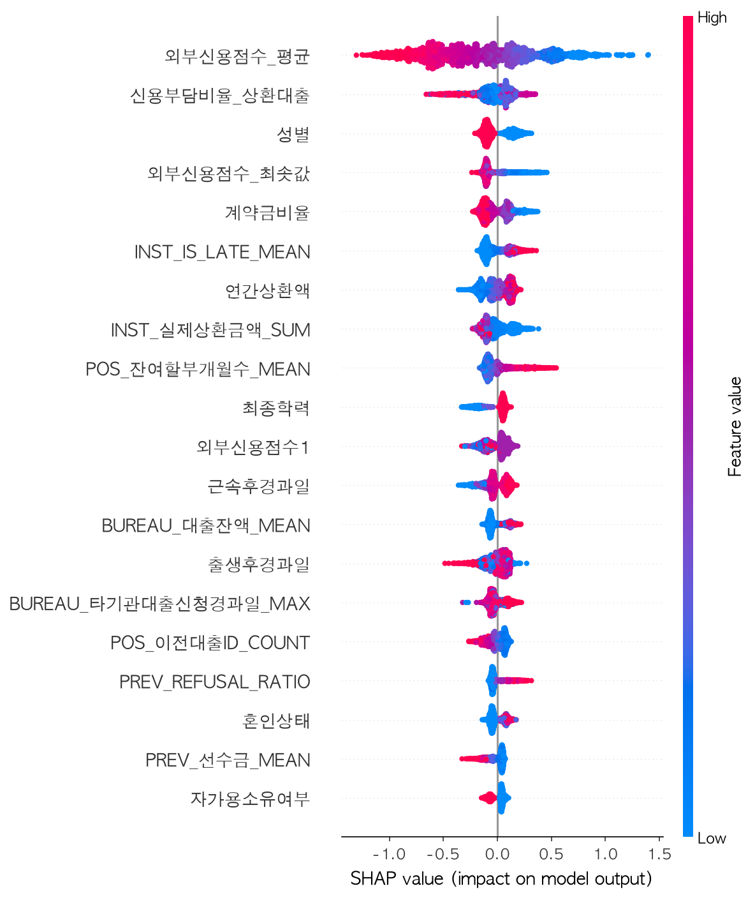
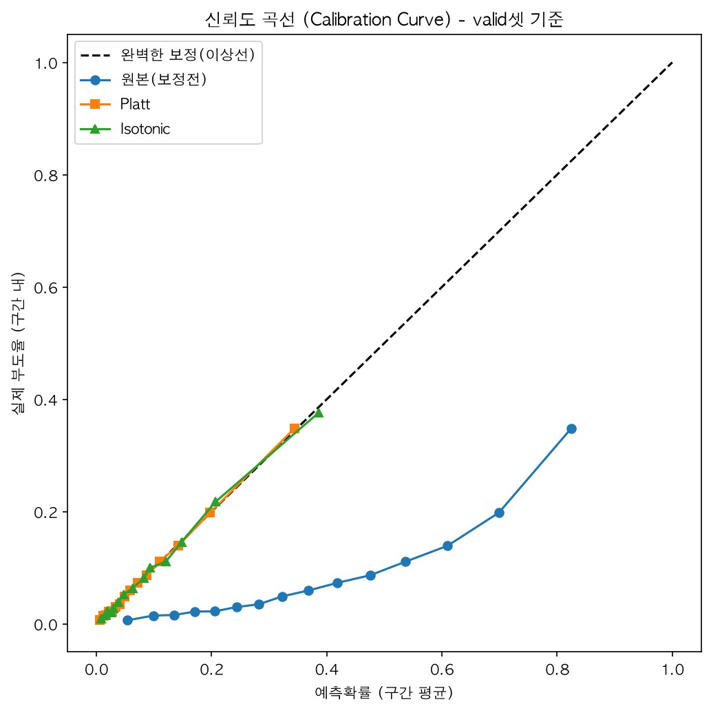
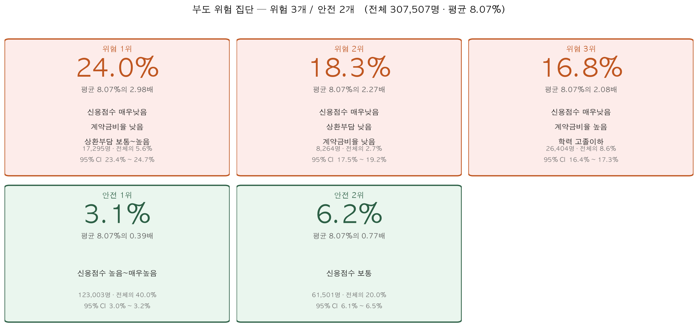

# Home Credit 대출 부도 예측 및 A\~E 신용등급 모델

고객 한 명의 대출 부도 확률을 예측하고, 이를 **A(안전) \~ E(위험) 5단계 신용등급**과 **승인/거절 의사결정 규칙**으로 바꾸는 end-to-end 분석 프로젝트입니다.
단순히 AUC를 높이는 데서 끝나지 않고, **불균형 처리 → 임계값(비용 기반) → 확률 보정 → 등급 변환 → 공정성 검증 → 새 테스트셋 검증**까지 실제 신용평가 흐름대로 진행했습니다.

> 프로젝트 기간: 2026.08.03 \~ 2026.08.25 · 인원/내 역할: 4명/전 과정 공동 수행

## 핵심 결과

| 항목 | 결과 |
|---|---|
| 데이터 | Kaggle *Home Credit Default Risk* (7개 테이블, 고객 약 30.7만 명, 부도율 8.07%) |
| 최종 모델 | XGBoost (`scale_pos_weight`로 불균형 보정) |
| 성능 (AUC) | 검증셋 0.791 → **한 번도 쓰지 않은 새 테스트셋 0.785** (과최적화 아님을 확인) |
| 교차검증 (5-fold) | XGBoost 0.7838 ± 0.0046 · CatBoost 0.7830 · LightGBM 0.7810 · 로지스틱 0.7674 |
| 확률 보정 | Platt scaling으로 평균 예측확률 36.3% → 8.1% (실제 부도율 8.07%), Brier 0.167 → 0.066 |
| 등급별 실제 부도율 (새 테스트셋) | A 1.2% · B 2.8% · C 5.7% · D 11.3% · E 27.0% (등급이 올라갈수록 단조 증가) |
| 위험 집단 | 신용점수 매우낮음 + 계약금비율 낮음 + 상환부담 보통\~높음 → 부도율 24.0% (평균의 3.0배) |



## 분석 흐름

| 단계 | 스크립트 | 내용 |
|---|---|---|
| 데이터 구축 | `03_다중테이블_병합집계.py` | 7개 테이블을 고객 단위(`SK_ID_CURR`)로 집계·병합 (bureau_balance → bureau → 고객의 2단계 집계) |
| 전처리 | `04`, `04b` | 결측치·이상치 분석, 변수 유형별 결측 처리 가이드 적용 (04 vs 04b 비교 후 04b 채택) |
| EDA | `06_EDA_통계검정.py` | Mann-Whitney U(수치형), 카이제곱(범주형) 검정, 상관관계 |
| 피처 | `07`, `08` | 파생변수 16개 생성, 모델 계열별 인코딩·스케일링(라벨/원-핫+표준화/WoE) |
| 모델링 | `05`, `05b`, `09`, `10`, `11`, `12`, `13` | 4개 모델 비교(`05b`는 파생변수 포함 버전), 인코딩 버전 비교, 기준모델(Dummy·로지스틱), 불균형 처리 비교, 12종 알고리즘 비교, 5-fold CV·하이퍼파라미터 튜닝 |
| 의사결정 | `14`, `14_1`, `15_1` | 비용 기반 임계값(FN:FP), LGD×순이익률 배율 계산 |
| 해석 | `16_SHAP_해석.py` | 전역(summary)·개별(waterfall) 해석 |
| 확률·등급 | `17`, `18`, `19`, `23` | 확률 보정, A\~E 등급 변환, 등급별 프로파일링, 기대손익 기반 승인/거절 규칙 |
| 검증 | `20`, `21` | 성별 공정성 검증, 새 테스트셋 검증 |
| 배포용 | `24`, `25` | 최종 모델·아티팩트 저장, `score_customer()`로 신규 고객 1명 채점 |
| 세분화 | `30`, `31`, `32` | 세그먼트 통합 파이프라인(단변량 탐색·의사결정나무·K-Means 교차검증), SHAP 상위 변수 기반 위험 집단 나무, 파생변수 효과 통제 비교 |

번호는 작업 순서이며, 저장소에 포함하지 않은 번호는 아래와 같습니다.

| 번호 | 단계 | 제외 사유 |
|---|---|---|
| 01 · 02 | 데이터 수집 · 컬럼명 한국어 번역 | 원본 데이터 가공 단계로 분석 로직이 아님 |
| 15 | 이자계산 기반 FN:FP 배율 (3.22:1) | "대출 원금 전액 손실" 가정이 과도해 15_1(LGD × 순이익률, 5.21:1)로 대체 |
| 22 | 등급별 범주형 프로파일링 | 결과 해석용 표·그래프 전용. 후속 단계가 참조하지 않음 |
| 26 \~ 29 | 세그먼트 초기 탐색 (변수별 부도율, 교차 매트릭스, K-Means, 의사결정나무) | 30번 통합 파이프라인으로 재설계되어 흡수됨 |

## 주요 분석 포인트

**1. 불균형 데이터에서 "정확도의 함정" 확인**
부도는 전체의 약 8%라서 무조건 "정상"만 찍는 Dummy 모델도 정확도 91.9%가 나오지만 AUC는 0.5, Recall은 0입니다. 그래서 AUC·Recall·Precision을 함께 봤습니다.

**2. 오버샘플링(SMOTE 등)은 채택하지 않음**
SMOTE/ADASYN은 학습셋 AUC 0.97인데 검증셋은 0.71로 크게 떨어졌습니다(과적합). `class_weight`/`scale_pos_weight` 방식이 검증 성능이 더 좋아 채택했습니다.

**3. 파생변수 효과를 통제된 조건에서 비교**
같은 입력·같은 분할·같은 하이퍼파라미터로 피처만 바꿔 비교했습니다(`32_파생변수_효과검증.py`). XGBoost 검증 AUC 0.7795 → 0.7842 (피처 141 → 157개).

**4. 확률 보정으로 "진짜 확률" 복원**
`scale_pos_weight`로 학습하면 순위(AUC)는 좋아지지만 확률값은 부풀려집니다(평균 36% vs 실제 8%). 등급과 기대손익을 계산하려면 확률 자체가 의미 있어야 하므로 Platt 보정을 적용했습니다.



**5. 임계값을 비용으로 결정**
기본값 0.5 대신 Youden's J, F1 최대화, FN:FP 비용비율 기반 방식을 비교하고, 비용비율(4:1) 근거로 임계값 약 0.665를 확정했습니다.

**6. 검증셋 재사용 문제를 새 테스트셋으로 점검**
임계값·보정·등급 구간을 모두 같은 검증셋으로 정했기 때문에 과최적화 가능성이 있었습니다. 그래서 어떤 결정에도 쓰이지 않은 새 테스트셋에 확정된 규칙을 그대로 적용해 AUC 차이가 약 0.006에 그치고 등급별 부도율 패턴이 유지됨을 확인했습니다.

**7. 성별 공정성 검증**
SHAP 상위 변수에 성별이 포함되어 있어, 성별을 제거한 모델과 비교했습니다. 성별을 제거해도 다른 변수(프록시)를 통해 성별 간 고위험 판정률 격차가 줄어들 뿐 완전히 사라지지는 않았습니다(남성 17.8% / 여성 9.9% → 16.1% / 10.9%). 단, 데이터상 실제 부도율 자체도 성별로 다르므로(남성 약 10.2%, 여성 약 7.0%) 이 결과는 "성별 제거만으로는 공정성 문제가 해결되지 않는다"는 점을 보여주는 수준으로 해석했습니다.

**8. 위험 집단을 사람이 읽을 수 있는 규칙으로**
SHAP 상위 변수를 3\~5단계 등급으로 바꿔 의사결정나무에 넣어, "신용점수 매우낮음 · 계약금비율 낮음 · 상환부담 보통\~높음 → 부도율 24.0%"처럼 문장으로 읽히는 위험 집단 8개를 도출했습니다(부도율 3.1% \~ 24.0%, `31_위험집단_나무.py`).



## 한계와 가정

- 기대손익 계산은 **LGD 0.45, 순이익률 8%** 라는 가정에 기반합니다(실제 은행 데이터가 아님).
- 데이터는 Kaggle 공개 데이터를 한국어로 번역해 사용했고, 대출 상환 기간·금리 정보가 없어 이자수익은 근사치입니다.
- 모델 해석(SHAP)과 공정성 분석은 이 데이터셋 안에서의 결과이며 실제 규제 적합성 판단은 아닙니다.

## 실행 방법

1. 의존 패키지 설치
   ```bash
   pip install -r requirements.txt
   ```
2. 데이터 준비: [Kaggle Home Credit Default Risk](https://www.kaggle.com/c/home-credit-default-risk/data)에서 데이터를 내려받아 `data/` 폴더에 둡니다. (용량 문제로 저장소에는 포함하지 않았습니다.)
3. 각 스크립트 상단의 `UP`(입력 폴더), `OUT`(출력 폴더) 경로를 본인 환경에 맞게 수정합니다.
4. 번호 순서대로 실행합니다. 앞 단계가 만든 파일(`.pkl`, `.npy`)을 뒤 단계가 읽습니다.
   예) `03` → `04b` → `07` → `08` → `12` → `14` → `17` → `18` → `24` → `25`

## 기술 스택

Python · pandas · NumPy · SciPy · scikit-learn · XGBoost · LightGBM · CatBoost · SHAP · imbalanced-learn · matplotlib
